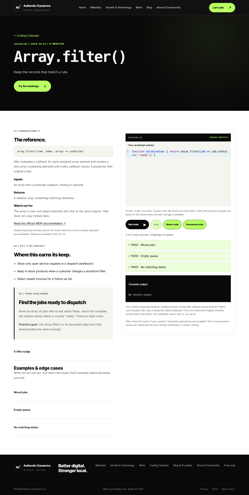
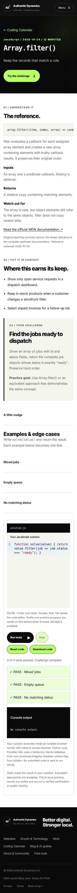

# Coding Calendar

This adds a daily learning area to the existing Flask/Jinja app. It is committed content and working application code, with no AI API or code-execution server. The first collection has 21 lessons: JavaScript, Python and SQLite SQL for October 24–30, 2026.

## Visitor experience

`/coding-calendar/` shows three language cards and an archive. Each card opens today's lesson or clearly labels the latest published lesson if today's content is missing. Dates follow America/New_York, including daylight saving time. Future lessons return 404 until their publication dates.

Each permanent page (`/coding-calendar/javascript/2026-10-24/`, for example) includes the exact method signature, an original explanation of inputs and return values, pitfalls, a link to the complete official documentation, three business scenarios, a challenge, examples, a hint, and a CodeMirror 6 editor. Users can run tests, inspect failures and console output, stop execution, restore starter code, and download their solution. Drafts and completion timestamps stay in localStorage on that browser and device. No login is required, and progress does not sync across devices.

JavaScript executes as actual JavaScript. Python uses CPython compiled to WebAssembly through pinned Pyodide 0.27.7. SQL runs in an actual temporary SQLite database through sql.js 1.13.0, never the business database. Python's initial runtime download is approximately 13.8 MB before HTTP compression; SQL's is approximately 0.7 MB. Only the selected language's runtime is downloaded. Runtime downloads use jsDelivr with credentials omitted, no referrer, and SHA-256/size verification against the committed manifest. CodeMirror's compiled editor is served locally.

## What is written to GitHub

- One editable JSON source file per language per date under `authentic_dynamics/content/coding/`.
- Flask routes and shared Jinja templates that render permanent HTML lesson URLs.
- Locally bundled CodeMirror editor, original editable editor source, lockfile and rebuild command.
- Browser runner, integrity manifest, styles, trusted reference solutions and regression tests.
- Links from the tools catalog and site footer.

There are no throwaway generated pages or browser-only lesson definitions. The JSON files are the durable content source; templates render their HTML on requests. Full upstream manuals are linked rather than copied wholesale. No database migration or API credential is required.

## Execution boundary

1. The trusted parent fetches and verifies runtime files. It never evaluates learner code.
2. A new iframe is created for each run with `sandbox="allow-scripts"`, without `allow-same-origin`. Its response also applies CSP `sandbox allow-scripts`.
3. The frame starts a new blob worker. The worker inherits a CSP with `connect-src 'none'`, `default-src 'none'`, and only blob/inline/evaluation permissions needed for its runtime. The opaque origin prevents access to site cookies, localStorage, DOM and authenticated application data.
4. Runtime bootstrap receives verified bytes by structured clone. A temporary fetch shim serves only these in-memory resources; native network access is still blocked by CSP. After initialization, the shim denies all fetches. Worker creation, XHR, WebSocket, EventSource and importScripts are also disabled before learner code runs. Those API overrides are defense in depth; the browser origin and CSP are the boundaries.
5. Results travel through a MessageChannel and are rendered as text. The frame cannot request privileged server actions. No endpoint accepts or executes submitted code.
6. Execution is limited to five seconds after startup, with a 90-second total setup limit, Stop, a 20,000-character source cap, 12,000-character console cap and 100 KB normal result cap. Each SQL case gets a fresh database and a 1,000-row result cap.

Tests and expected results are intentionally visible. Correctness checks accept equivalent solutions; they do not prove use of a particular method. This is a learning tool, not adversary-resistant judging, verified certification or a leaderboard. A determined learner can forge local results. Browsers provide no strict per-worker memory quota here: excessive allocation can exhaust a visitor's tab. Runtime/package installation and network-dependent programs are out of scope. Browser-level vulnerabilities are outside this boundary. Chromium browser execution is verified; WebKit/Firefox runtime compatibility should be checked before claiming universal support. A separate runner origin is an appropriate additional boundary if execution later moves beyond this browser-only learning scope.

## Add a day

Copy an existing JSON file into the appropriate language directory using `YYYY-MM-DD.json`. Update its date, reference, content, starter and tests, and add a trusted solution to `tests/fixtures/coding/solutions.json`. Keep the fields consistent with existing examples. Python/JavaScript challenges define synchronous `solve(value)` returning a JSON-compatible value. SQL uses a single SELECT/WITH query and exact expected column names and row order.

Add one lesson for each track on the same day, review the official reference and reference solution, then commit. No cron is needed for publication: the server compares the scheduled date with the current New York date. The initial queue ends October 30; new content must be authored to continue daily publication. After that, the archive remains usable and the page explicitly reports that no lesson is scheduled today.

## Rebuild editor

```sh
npm ci --prefix tools/coding-editor
npm run build --prefix tools/coding-editor
```

Commit `editor.bundle.js` whenever editor source or dependency versions change. The editor dependency license texts are retained in `static/js/coding/THIRD_PARTY_LICENSES.txt`.

## Verify

```sh
python -m pip install -e '.[dev]'
pytest -q
npm install --no-save --prefix /tmp/coding-browser playwright
NODE_PATH=/tmp/coding-browser/node_modules /tmp/coding-browser/node_modules/.bin/playwright install --with-deps chromium
NODE_PATH=/tmp/coding-browser/node_modules python scripts/test_coding_browser.py
```

The browser suite exercises all 21 trusted reference solutions in real runtimes. Python code in the test-only server launcher makes future-dated seed lessons available solely in that local test process. It also checks incorrect answers, exception text rendering, loop timeout, manual cancellation, network denial, draft persistence, reset, downloads, mobile overflow and absence of code-upload requests. `CODING_RUNTIME_CACHE` may point to an offline directory containing the pinned runtime files; integrity checks still run against their actual bytes. `CODING_CHROMIUM_PATH` optionally selects an installed Chromium executable. `CODING_BASE_URL` selects an already-running test server for direct invocation of the Node suite.

## Deployment

Merge the review branch, deploy it through the normal PythonAnywhere workflow and reload the app. Ensure the deployment includes `content/coding/`, the new templates and static files. No schema or secret changes are required. This branch is not a live deployment. Verify the catalog, a JavaScript run, a Python run and a SQL run over HTTPS after deployment. Ensure any upstream reverse proxy preserves the `/coding-calendar/sandbox` CSP header; do not add allow-same-origin to the frame. No sitemap changes were made because this repository deliberately distinguishes business search pages from utility discovery; these pages remain linked from the catalog and footer.

## Validation recorded for this change

- Full Python suite: **241 passed**.
- Browser reference solutions: **all 21 challenges passed**, covering **65 example and edge-case assertions** across JavaScript, actual Pyodide Python and SQLite.
- Additional browser checks passed: incorrect result feedback, safe exception display, five-second endless-loop termination, Stop, opaque iframe origin, network denial, persisted drafts, reset, code download, hidden fallback textarea and 390 px mobile overflow.
- Runtime files in the full browser run were supplied from an offline cache of the actual pinned distribution bytes; SHA-256 verification and real runtime execution remained active. Runtime download availability over a visitor's network is therefore a separate deployment check.
- The screenshots below are captured from the running application, with a passing JavaScript solution.

### Desktop



### Mobile


